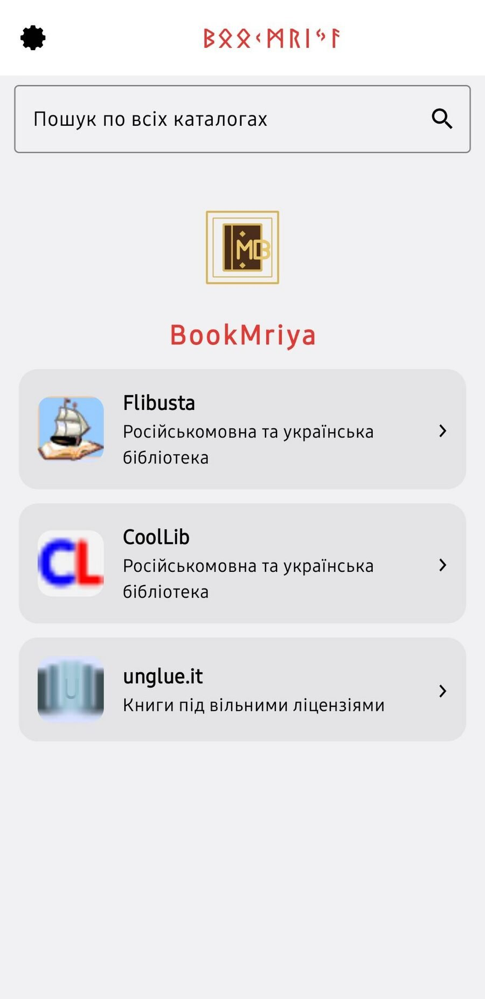
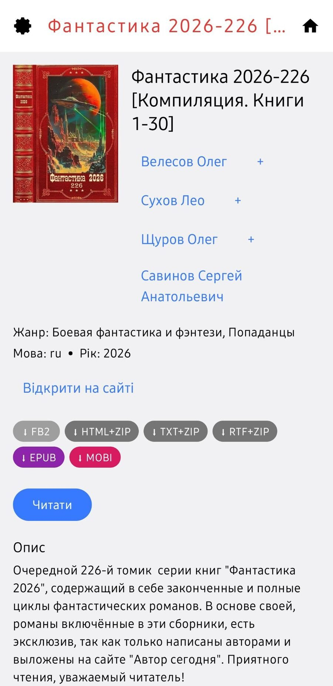
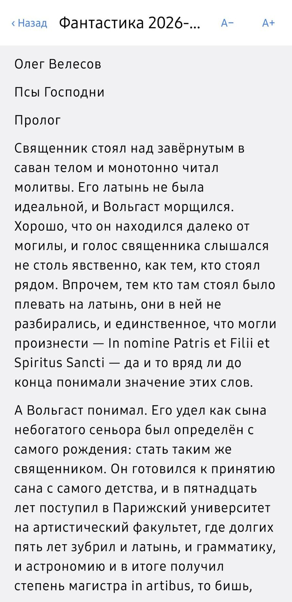
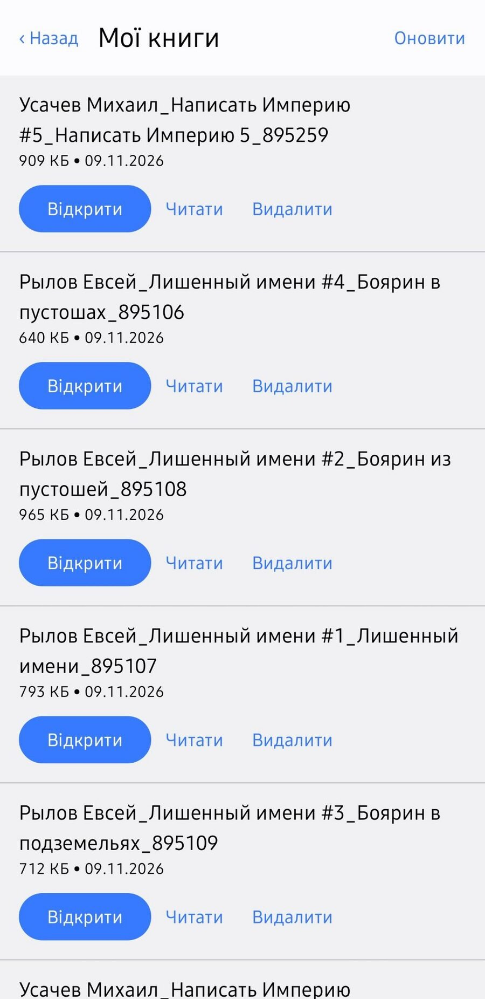
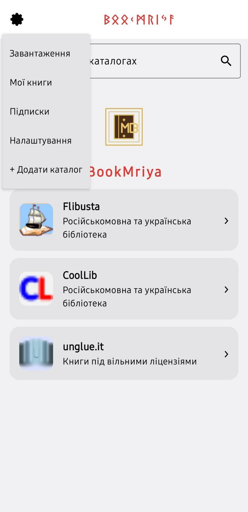
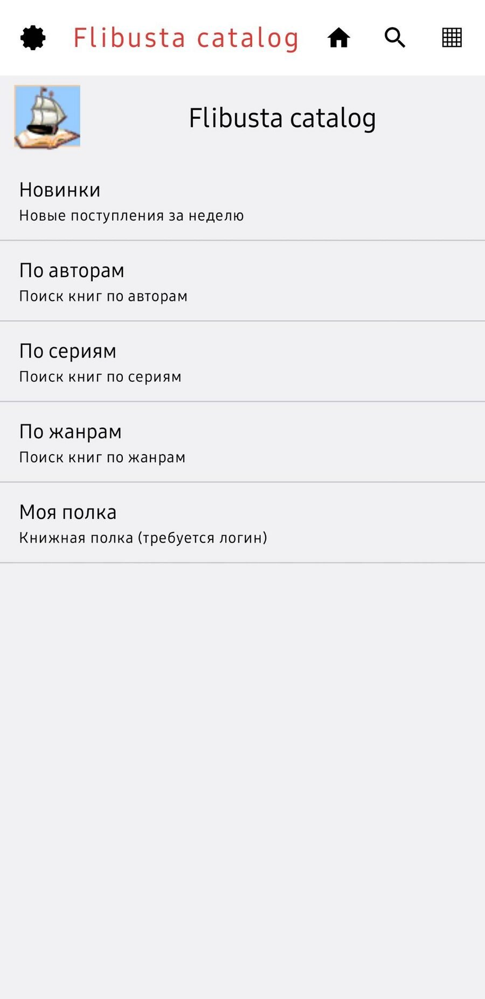
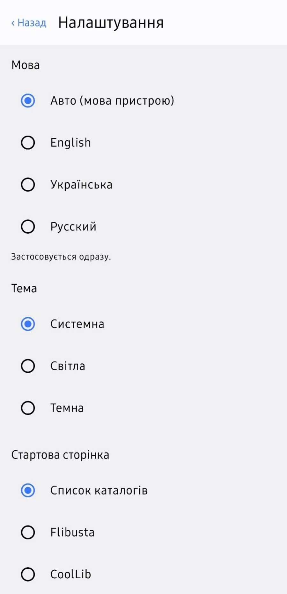
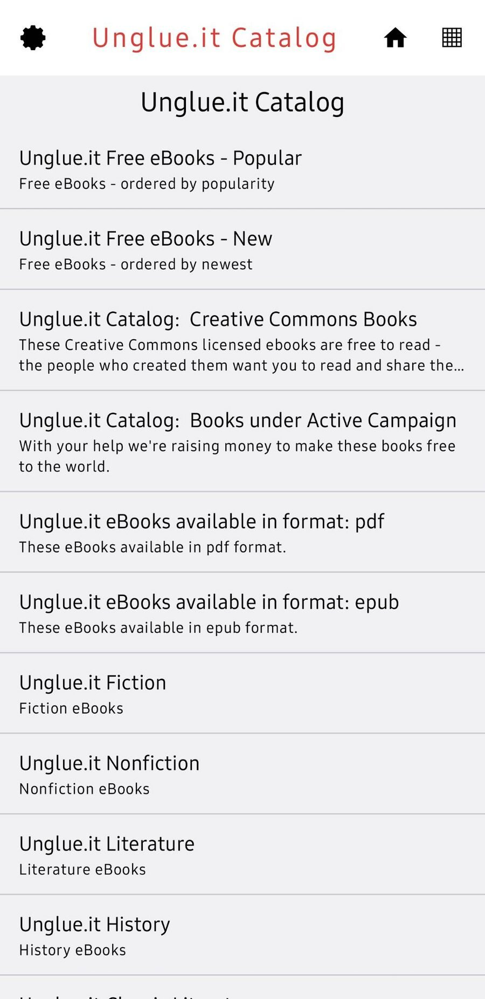

# BookMriya (AllBooks)

**[Українська](#українська)** · **[English](#english)** · **[Русский](#русский)**

OPDS client for Android · OPDS-клієнт для Android · OPDS-клиент для Android

<p align="center">
  
  
  
  
</p>

---

## Українська

OPDS-клієнт для Android: каталоги електронних книг, завантаження, вбудована читалка та підписки.

Підтримує Flibusta, CoolLib, unglue.it і власні OPDS-каталоги (з логіном/паролем за потреби).

### Можливості

- **Каталоги OPDS** — перегляд стрічок, пошук у каталозі та глобальний пошук одразу по кількох джерелах
- **Власні каталоги** — додавання URL, опційна авторизація
- **Завантаження** — через системний DownloadManager або у вибрану папку (SAF); з проксі/DoH — через OkHttp
- **Мої книги** — список завантажених файлів, відкриття зовнішньою читалкою або вбудованою
- **Вбудована читалка** — FB2, FB2.ZIP, EPUB, TXT; розмір шрифту (A−/A+) та пам’ять позиції
- **Підписки** — фонова перевірка нових книг (раз на день), накопичення міток «НОВЕ», сповіщення
- **Мережа** — HTTP/SOCKS5 проксі, DNS over HTTPS (Cloudflare)
- **Тема** — системна / світла / темна, Material You (динамічні кольори)
- **Мови інтерфейсу** — українська, англійська, російська

### Скріншоти

| Головний екран | Меню | Каталог |
|:---:|:---:|:---:|
|  |  |  |

| Книга | Читалка | Мої книги |
|:---:|:---:|:---:|
|  |  |  |

| Налаштування | unglue.it |
|:---:|:---:|
|  |  |

### Вимоги

- Android 7.0+ (API 24)
- Дозволи: інтернет; на Android 13+ — сповіщення; до Android 12 включно — доступ до сховища (далі — вибір папки через файловий менеджер)

### Збірка

Потрібні JDK 17 і Android SDK.

```bash
# З Gradle Wrapper (після додавання в репозиторій):
./gradlew assembleDebug

# Або через встановлений Gradle (як у CI):
gradle assembleDebug

# APK:
# app/build/outputs/apk/debug/app-debug.apk
```

Підписаний debug-збір через GitHub Actions (`Build APK`) з’являється в Artifacts після push у `main`.

#### Секрети CI для підпису

| Secret | Опис |
|--------|------|
| `KEYSTORE_BASE64` | Keystore у Base64 |
| `KEYSTORE_PASSWORD` | Пароль сховища та ключа |

Локально: змінні середовища `KEYSTORE_FILE` і `KEYSTORE_PASSWORD`.

### Структура проєкту

```
app/
  src/main/java/app/allbooks/
    MainActivity.kt      # головний UI (каталоги, стрічки, пошук)
    Downloads.kt         # завантаження DM + SAF + OkHttp (проксі)
    Reader.kt            # вбудована читалка FB2/EPUB/TXT
    MyBooks.kt           # список локальних книг
    SettingsStore.kt     # налаштування
    SecretBox.kt         # шифрування паролів (Android Keystore)
    Theme.kt             # Material 3 + Material You
    opds/                # моделі та парсер OPDS/Atom
    net/                 # OkHttp, проксі, DoH
.github/workflows/build.yml
docs/screenshots/        # скріншоти для README
```

### Бібліотеки

- Jetpack Compose + Material 3
- OkHttp (+ DNS over HTTPS)
- Coil (обкладинки)
- Kotlin Coroutines

Сторонніх «важких» читалок немає: FB2/EPUB розбираються власним кодом (XmlPullParser).

### Каталоги за замовчуванням

| Назва | Примітка |
|-------|----------|
| [Flibusta](http://flibusta.is/opds) | OPDS, HTTP |
| [CoolLib](https://coollib.com/opds) | OPDS |
| [unglue.it](https://unglue.it/api/opds/) | Вільні ліцензії |

Інші джерела можна додати в налаштуваннях.

### Ліцензія

Код поширюється за ліцензією [MIT](LICENSE).  
Каталоги третіх сторін мають власні умови використання — застосунок лише клієнт OPDS.

### Зворотний зв’язок

[Issues](https://github.com/Levi-boss/allbooks/issues). У налаштуваннях застосунку є «Поділитися логами» (без паролів).

---

## English

OPDS client for Android: ebook catalogs, downloads, a built-in reader, and subscriptions.

Supports Flibusta, CoolLib, unglue.it, and custom OPDS catalogs (optional login/password).

### Features

- **OPDS catalogs** — browse feeds, in-catalog search, and global search across several sources
- **Custom catalogs** — add a URL, optional authentication
- **Downloads** — system DownloadManager or a user-picked folder (SAF); with proxy/DoH — via OkHttp
- **My books** — local library; open with an external reader or the built-in one
- **Built-in reader** — FB2, FB2.ZIP, EPUB, TXT; font size (A−/A+) and last position
- **Subscriptions** — daily background check for new books, accumulating “NEW” badges, notifications
- **Network** — HTTP/SOCKS5 proxy, DNS over HTTPS (Cloudflare)
- **Theme** — system / light / dark, Material You (dynamic colors)
- **UI languages** — Ukrainian, English, Russian

### Screenshots

| Home | Menu | Catalog |
|:---:|:---:|:---:|
|  |  |  |

| Book | Reader | My books |
|:---:|:---:|:---:|
|  |  |  |

| Settings | unglue.it |
|:---:|:---:|
|  |  |

### Requirements

- Android 7.0+ (API 24)
- Permissions: internet; notifications on Android 13+; storage only through Android 12 (then folder access via the system file picker)

### Build

JDK 17 and Android SDK required.

```bash
# With Gradle Wrapper (once added to the repo):
./gradlew assembleDebug

# Or system Gradle (as in CI):
gradle assembleDebug

# APK:
# app/build/outputs/apk/debug/app-debug.apk
```

Signed debug builds from GitHub Actions (`Build APK`) appear under Artifacts after a push to `main`.

#### CI signing secrets

| Secret | Description |
|--------|-------------|
| `KEYSTORE_BASE64` | Keystore as Base64 |
| `KEYSTORE_PASSWORD` | Store and key password |

Locally: environment variables `KEYSTORE_FILE` and `KEYSTORE_PASSWORD`.

### Project layout

```
app/
  src/main/java/app/allbooks/
    MainActivity.kt      # main UI (catalogs, feeds, search)
    Downloads.kt         # DM + SAF + OkHttp (proxy) downloads
    Reader.kt            # built-in FB2/EPUB/TXT reader
    MyBooks.kt           # local books list
    SettingsStore.kt     # settings
    SecretBox.kt         # password encryption (Android Keystore)
    Theme.kt             # Material 3 + Material You
    opds/                # OPDS/Atom models and parser
    net/                 # OkHttp, proxy, DoH
.github/workflows/build.yml
docs/screenshots/        # README screenshots
```

### Libraries

- Jetpack Compose + Material 3
- OkHttp (+ DNS over HTTPS)
- Coil (covers)
- Kotlin Coroutines

No heavy third-party readers: FB2/EPUB are parsed with XmlPullParser.

### Default catalogs

| Name | Note |
|------|------|
| [Flibusta](http://flibusta.is/opds) | OPDS, HTTP |
| [CoolLib](https://coollib.com/opds) | OPDS |
| [unglue.it](https://unglue.it/api/opds/) | Free-licensed books |

Add more OPDS roots in settings.

### License

This project is licensed under the [MIT License](LICENSE).  
Third-party catalogs have their own terms; this app is only an OPDS client.

### Feedback

[Issues](https://github.com/Levi-boss/allbooks/issues). Settings include “Share logs” (no passwords).

---

## Русский

OPDS-клиент для Android: каталоги электронных книг, загрузки, встроенная читалка и подписки.

Поддерживает Flibusta, CoolLib, unglue.it и свои OPDS-каталоги (логин/пароль при необходимости).

### Возможности

- **Каталоги OPDS** — ленты, поиск в каталоге и глобальный поиск сразу по нескольким источникам
- **Свои каталоги** — добавление URL, опциональная авторизация
- **Загрузки** — системный DownloadManager или выбранная папка (SAF); с прокси/DoH — через OkHttp
- **Мои книги** — список загруженных файлов, открытие внешней или встроенной читалкой
- **Встроенная читалка** — FB2, FB2.ZIP, EPUB, TXT; размер шрифта (A−/A+) и запоминание позиции
- **Подписки** — фоновая проверка новых книг (раз в день), накопление меток «НОВОЕ», уведомления
- **Сеть** — HTTP/SOCKS5 прокси, DNS over HTTPS (Cloudflare)
- **Тема** — системная / светлая / тёмная, Material You (динамические цвета)
- **Языки интерфейса** — украинский, английский, русский

### Скриншоты

| Главный экран | Меню | Каталог |
|:---:|:---:|:---:|
|  |  |  |

| Книга | Читалка | Мои книги |
|:---:|:---:|:---:|
|  |  |  |

| Настройки | unglue.it |
|:---:|:---:|
|  |  |

### Требования

- Android 7.0+ (API 24)
- Разрешения: интернет; на Android 13+ — уведомления; до Android 12 включительно — доступ к хранилищу (далее — выбор папки через файловый менеджер)

### Сборка

Нужны JDK 17 и Android SDK.

```bash
# С Gradle Wrapper (после добавления в репозиторий):
./gradlew assembleDebug

# Или системный Gradle (как в CI):
gradle assembleDebug

# APK:
# app/build/outputs/apk/debug/app-debug.apk
```

Подписанная debug-сборка через GitHub Actions (`Build APK`) появляется в Artifacts после push в `main`.

#### Секреты CI для подписи

| Secret | Описание |
|--------|----------|
| `KEYSTORE_BASE64` | Keystore в Base64 |
| `KEYSTORE_PASSWORD` | Пароль хранилища и ключа |

Локально: переменные окружения `KEYSTORE_FILE` и `KEYSTORE_PASSWORD`.

### Структура проекта

```
app/
  src/main/java/app/allbooks/
    MainActivity.kt      # основной UI (каталоги, ленты, поиск)
    Downloads.kt         # загрузки DM + SAF + OkHttp (прокси)
    Reader.kt            # встроенная читалка FB2/EPUB/TXT
    MyBooks.kt           # список локальных книг
    SettingsStore.kt     # настройки
    SecretBox.kt         # шифрование паролей (Android Keystore)
    Theme.kt             # Material 3 + Material You
    opds/                # модели и парсер OPDS/Atom
    net/                 # OkHttp, прокси, DoH
.github/workflows/build.yml
docs/screenshots/        # скриншоты для README
```

### Библиотеки

- Jetpack Compose + Material 3
- OkHttp (+ DNS over HTTPS)
- Coil (обложки)
- Kotlin Coroutines

Тяжёлых сторонних читалок нет: FB2/EPUB разбираются своим кодом (XmlPullParser).

### Каталоги по умолчанию

| Название | Примечание |
|----------|------------|
| [Flibusta](http://flibusta.is/opds) | OPDS, HTTP |
| [CoolLib](https://coollib.com/opds) | OPDS |
| [unglue.it](https://unglue.it/api/opds/) | Свободные лицензии |

Другие источники можно добавить в настройках.

### Лицензия

Код распространяется по лицензии [MIT](LICENSE).  
Каталоги третьих сторон имеют свои условия — приложение только OPDS-клиент.

### Обратная связь

[Issues](https://github.com/Levi-boss/allbooks/issues). В настройках приложения есть «Поделиться логами» (без паролей).
